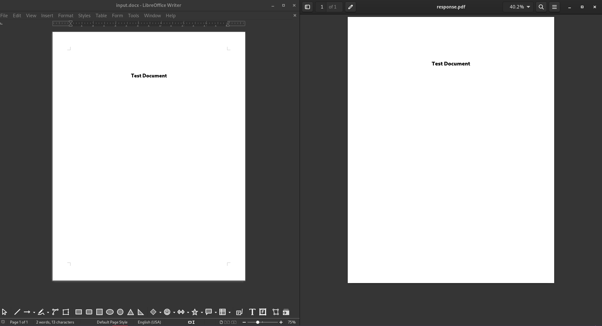
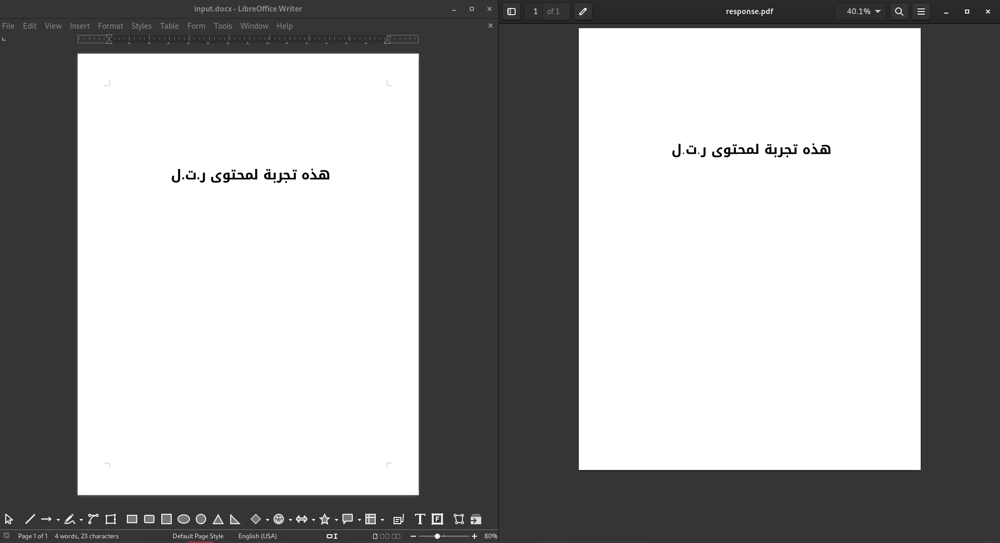
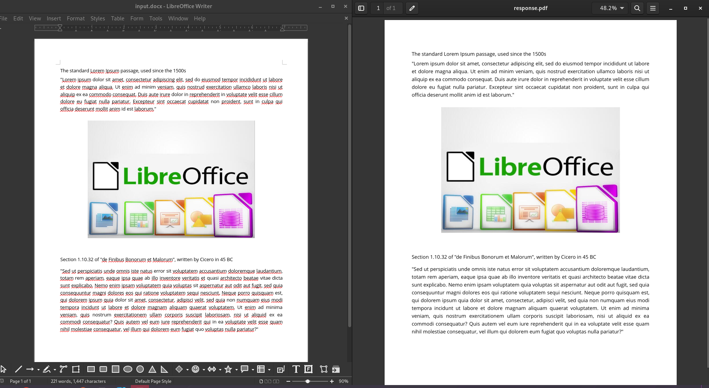
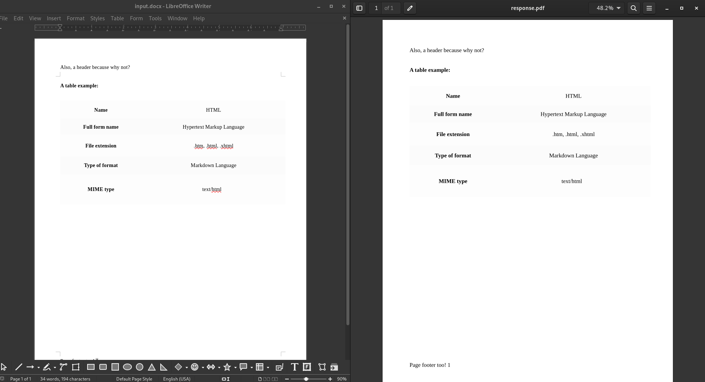

# Docx To PDF

> [!IMPORTANT]  
> As of v3.0.0, the service has been rewritten in Rust on top of `LibreOfficeKit` (`libsofficeapp.so`), replacing the JVM/Spring Boot + UNO socket bridge.
>
> If you wish to use or look at the old Node.js source code, you can do so by checking out the `nodejs` branch.

## Overview
This tool transforms Microsoft Word Documents (DOCX) into PDF format.

# The Challenge

Though there's an abundance of tools for DOCX to PDF conversion, many face challenges such as:
- Preserving document formatting.
- Handling Right-to-Left (RTL) text.
- Properly displaying various fonts.

Further complicating matters, many of these tools demand specific environments and have multiple, often redundant, layers of abstraction.

Why is accurate DOCX conversion so challenging? The root of the issue lies in the DOCX specification, known as [**OOXML**](http://officeopenxml.com/index.php).

- **Origin & Complexity**: OOXML, an XML-based format for DOCX documents, was designed by Microsoft. Its specification is incredibly detailed, spanning over 6,000 pages. It even contains inconsistencies, leading to varied interpretations. [It's actually well over 6000 pages long and contradicts itself in some cases.](https://en.wikipedia.org/wiki/Standardization_of_Office_Open_XML#Technical)
- **Implementation Challenges**: The intricate nature of OOXML means that even Microsoft doesn't perfectly implement it in their official applications. The experience of opening a DOCX file can differ between platforms like macOS and Windows.
- **Contrast with PDFs**: PDFs operate on a different structural and conceptual paradigm than DOCX files:
  - They use vector graphics.
  - Text is encoded as streams, not plain text
  - - [Read more about how PDFs work.](https://en.wikipedia.org/wiki/PDF#Imaging_model)

Given these complexities, creating a flawless DOCX to PDF converter remains a daunting challenge, with no full-proof solution in sight.
Not anytime soon.


# LibreOffice to the rescue 
LibreOffice, a powerful open-source office suite, has consistently strived to enhance compatibility with Microsoft Office formats, particularly the .docx format. This is crucial to ensure that users transitioning from Microsoft Office to LibreOffice can continue working with their documents seamlessly.

It offers built-in APIs and a server mode, enabling users to programmatically interface with it through 
[Universal Network Objects (UNO)](https://en.wikipedia.org/wiki/Universal_Network_Objects) API.

While not perfect, it is still the best available solution for free for rendering docx formats.


# Proposed Solution
This service is built in Rust (`axum` + `tokio`), exposing a simple HTTP API that takes a `.docx` file as input
and responds with an `application/pdf` file.

During initialization, the supervisor spawns a pool of pre-warmed worker processes that load LibreOffice's C library (`libsofficeapp.so` via `libreofficekit_hook_2`) directly in-process:
1. Load the document (`documentLoad`).
2. Export the document as PDF (`saveAs`).
3. Return the PDF bytes to the caller.

If a worker crashes, the supervisor terminates it, spawns a fresh pre-warmed worker in the background, and retries the conversion. A conversion deadline returns HTTP 504 and replaces the worker for subsequent requests.

# Installation Guide
## Using docker
You can pull the latest built docker image from Dockerhub:
```shell
docker pull moalhaddar/docx-to-pdf:latest
```

Then you can run the service:
```shell
docker run \
 --rm --name docx-to-pdf \
 --read-only --cap-drop=ALL --security-opt=no-new-privileges \
 --tmpfs /tmp:rw,nosuid,nodev,noexec,size=512m,mode=1777 \
 -p 8080:8080  \
 -e "pool.size=1" \
 -v ./fonts:/usr/share/fonts/custom:ro \
  moalhaddar/docx-to-pdf:latest
```

Some details:
- `pool.size`: In case you need more workers. Omit if not needed. .Read more in the [performance](#performance) section.
- `/usr/share/fonts/custom`: In case you need custom fonts. Omit if not needed. Read more in the [fonts](#fonts) section.

## Locally

To run this service locally, you will need the following:
- Rust toolchain (`cargo` / `rustc`)
  - Install via [rustup.rs](https://rustup.rs/)
- LibreOffice installed on the system (`libsofficeapp.so` under `/usr/lib/libreoffice/program` or `/usr/lib64/libreoffice/program`)
  - ```shell
      $ libreoffice --version
        LibreOffice 7.5.6.2 50(Build:2)
    ```
- Landlock filesystem protection is best-effort: Linux hosts with ABI 3 support can enforce the full requested policy; older or restricted hosts use the available protection and log a warning when it is reduced or unavailable. Missing Landlock support does not prevent startup.
- Clone this repository and run the service:
  - ```shell
      $ cargo run --release -- --pool.size=1 --server.port=8080
    ```
- Expect the service to be running on port 8080 by default:
  ```
    Starting docx-to-pdf v3.0.0 (pool.size=1, port=8080)
    [LibreOffice/0] Starting server instance..
    [LibreOffice/0] PID: 2285545
    [LibreOffice/0] Ready and pre-warmed in 1327 ms
    Started docx-to-pdf on 0.0.0.0:8080 in 1327 ms
  ```

# Usage
Once the service is up and running, you can try hitting the service at the `/pdf` endpoint.

### Sample cURL:
```shell
curl --output output.pdf \
--location 'http://localhost:8080/pdf' \
--form 'document=@"/home/moalhaddar/example.docx"'
```

### Sample Fetch
```javascript
var formdata = new FormData();
formdata.append("document", fileInput.files[0], "file.docx");

var requestOptions = {
  method: 'POST',
  body: formdata,
};

fetch("http://localhost:8080/pdf", requestOptions)
  .then(response => response.text())
  .then(result => console.log(result))
  .catch(error => console.log('error', error));
```

# Examples
 The below example files are included within this repository [here](./examples)

### Example 1: Regular LTR Text with font


### Example 2: Regular RTL Text with font


### Example 3: An Image wtih text


### Example 4: A table


# Fonts
It will happen that you use a font in the docx document that is not included within your system. In that case, the said
font will need to be included either by:
- Saving the document with the fonts embedded. 
  - [How to do so in LibreOffice](https://help.libreoffice.org/latest/lo/text/shared/01/prop_font_embed.html)
  - [How to do so in Microsoft Office](https://support.microsoft.com/en-gb/topic/how-to-embed-a-truetype-font-in-a-document-883f5212-0c1a-28df-8bb1-21273fa67e7e)
- Storing the font in your system. You can do so by copying your fonts to anywhere within your `/usr/share/fonts/`
directory. Example
  ```shell
  $ cp ./fonts/DroidKufi-Bold.ttf /usr/share/fonts/
  ```
  
Then you will need to restart the service.

If the font is not included within the system/docker image, then the result PDFs will not look the same as the original
docx file.

The image includes Carlito and Caladea as metric-compatible fallbacks for Calibri and Cambria, alongside DejaVu, Liberation, Noto and the custom fonts. LibreOffice versions and other missing fonts can still affect layout; verify representative documents before upgrading.

## Compatibility and request limits

Both conversion endpoints and the `document` multipart field are retained. The default file and total multipart request limits are each 10 MiB; the request bound includes multipart overhead. Legacy `SPRING_SERVLET_MULTIPART_MAX_FILE_SIZE` and `SPRING_SERVLET_MULTIPART_MAX_REQUEST_SIZE` settings are supported independently, as are their dotted environment and `--spring.servlet.multipart.max-file-size=...` / `--spring.servlet.multipart.max-request-size=...` CLI forms. Sizes accept bytes or binary `B`, `KB`, `MB`, `GB`, `TB` units; `-1` disables the corresponding bound. The existing Rust `MAX_FILE_SIZE_MB` setting takes precedence over both legacy limits and sets both bounds to that many MiB. Invalid sizes fail startup instead of silently reverting to a larger default. All uploaded file parts and the complete multipart request are checked, including parts after `document`.

`SERVER_ADDRESS` (or `server.address` / `--server.address=...`) binds only the configured address; an explicit bind failure never falls back to a wildcard interface. When omitted, the default remains all interfaces. `SERVER_SERVLET_CONTEXT_PATH` (or `server.servlet.context-path` / `--server.servlet.context-path=...`) prefixes both conversion endpoints and every health endpoint. For `/convert`, use `/convert/pdf` and `/convert/actuator/health`; unprefixed routes are not exposed. Empty or `/` selects the root context, and trailing slashes are normalized. CLI values override the corresponding environment aliases.

The Rust service intentionally rejects empty documents with 400 and invalid/non-DOCX documents with 422 instead of attempting text conversion or returning 500. Oversized bodies return 413, a full request queue or exhausted worker wait returns 503, stalled uploads return 408, and conversion deadlines return 504. Errors use a JSON `status`/`error` body rather than Spring's error envelope. CORS preflights return 204 and allow requested headers, including Authorization. Clients should accept a successful 2xx preflight.

`/actuator/health/liveness` checks the supervisor, while `/actuator/health/readiness` and `/actuator/health` check worker availability. `/health` is an additional alias. These interfaces preserve the normal upload workflow; error responses are not byte-for-byte compatible with Spring Boot.

## Processing untrusted documents

Before loading LibreOffice or creating its threads, each worker attempts a [Landlock filesystem policy](https://docs.kernel.org/userspace-api/landlock.html) with `CompatLevel::BestEffort` and `no_new_privs`. With the full policy enforced, it can read installed engine resources, fonts and selected OS configuration; it can write only its own temporary profile/job tree and `/dev/null`. Jobs run inside that worker's private tree. Unrelated mounts, other workers' job trees, home directories and secrets under `/run` are then outside the policy. On older kernels only supported restrictions apply; when Landlock is unavailable or policy setup fails, the worker logs a warning and continues conversion without Landlock filesystem isolation. Do not assume filesystem isolation on every host. The supervisor does not pass its application environment to workers; only locale, timezone and `LO_PROGRAM_DIR` settings are inherited.

Do not mount secrets into the conversion container. Reused workers can access their own profile, and these restrictions are not a complete sandbox for native-code exploits. The image disables macro execution and automatic link updates and removes LibreOffice's HTTP/FTP content providers. Deploy with restricted outbound networking, CPU/memory/PID limits, a read-only root filesystem and a bounded `/tmp`, as appropriate for the workload; keep the image and LibreOffice patched. Embedded images are supported; external file-linked images outside the allowed resources are blocked only when the corresponding filesystem restrictions are active.

# Performance
This tool was designed with performance in mind. 

The default settings runs the service with one converter worker only. If you have enough system resources available and
need to increase the worker pool size, you can do so by providing the environment variable `pool.size` (or `POOL_SIZE` / `--pool.size=<N>`) to the service.

For manual browser load tests, see [index.html](./scripts/index.html) and [stress.js](./scripts/stress.js).

A local Linux/amd64 Docker comparison used one worker, 2 CPUs, 2 GiB memory and a 512 MiB `/tmp` tmpfs per service. The table gives median total times for 50 concurrent requests over three repetitions, after five warmup conversions per fixture. All 900 comparison requests returned 200. The baseline was v2.1.0 (`a692cfc`); the Rust image included the restored font fallbacks and filesystem restrictions described above.

| Document | Kotlin baseline | Rust | Speedup |
|----------|-----------------|------|---------|
| Original example 1 | 1.701s | 0.787s | 2.16x |
| Synthetic table/image | 3.132s | 2.450s | 1.28x |
| Synthetic long document (37 pages in both) | 9.026s | 6.159s | 1.47x |

These are workload- and host-specific observations, not a universal speedup or a comparison against other converters.

Keep in mind that the input file complexity matters a lot when it comes to the conversion performance.


If you have any performance observations, don't hesitate to open and report an issue.

# License
MIT License

# Author
Mohammad Alhaddar
